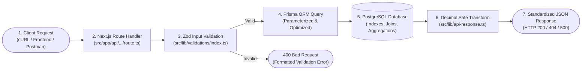

# OneAtlas — Backend REST API Documentation (Phase 3)

Welcome to the comprehensive API documentation for **OneAtlas**, an AI Model Discovery and Intelligence Platform built with Next.js App Router, TypeScript, Prisma ORM, PostgreSQL, and Zod.

---

## 1. Architectural Request Flow

Every incoming HTTP request follows a strict, defensive architecture:



### Standard Response Envelope
All successful API responses share a consistent envelope:
```json
{
  "success": true,
  "data": { ... } | [ ... ],
  "meta": { ... }
}
```

### Standard Error Envelope
All error responses share a predictable, safe structure (stack traces and database internals are never exposed):
```json
{
  "success": false,
  "error": {
    "message": "Human-readable error explanation",
    "code": "VALIDATION_ERROR | NOT_FOUND | BAD_REQUEST | INTERNAL_SERVER_ERROR",
    "details": [ ... ]
  }
}
```

---

## 2. API Endpoints Reference

### 2.1 Model Discovery & Filtering
* **Endpoint:** `GET /api/models`
* **Description:** Searches, filters, sorts, and paginates AI models using database-level operations.

#### Query Parameters
| Parameter | Type | Default | Description |
| :--- | :--- | :---: | :--- |
| `search` | String | Optional | Case-insensitive search matching model name or description |
| `company` | String | Optional | Filter by company slug (e.g., `openai`, `anthropic`) or ID |
| `provider` | String | Optional | Filter by provider slug (e.g., `aws-bedrock`, `openrouter`) or ID |
| `capability` | String | Optional | Filter by capability (e.g., `vision`, `code`, `reasoning`, `audio`) |
| `modelType` | String | Optional | Filter by model type (e.g., `multimodal`, `text-only`, `reasoning`, `code`) |
| `sortBy` | Enum | `releaseDate` | Sort field: `releaseDate`, `contextWindow`, `inputPrice`, `name` |
| `sortOrder` | Enum | `desc` | Ordering direction: `asc` or `desc` |
| `page` | Integer | `1` | Page number (minimum 1) |
| `limit` | Integer | `10` | Records per page (minimum 1, maximum 100) |

#### Example Request
```bash
curl -X GET "http://localhost:3000/api/models?company=anthropic&capability=vision&sortBy=contextWindow&sortOrder=desc&page=1&limit=2"
```

#### Example 200 OK Response
```json
{
  "success": true,
  "data": [
    {
      "id": "cmwrr9ksl000njlgczb35z9x9",
      "name": "Claude 3.5 Sonnet",
      "slug": "claude-3-5-sonnet",
      "description": "Industry-leading intelligence with exceptional coding, visual analysis, and agentic workflows. (Sample data)",
      "company": {
        "id": "cmwrr9h4m0001jlgc4ff19g71",
        "name": "Anthropic",
        "slug": "anthropic",
        "website": "https://anthropic.com"
      },
      "contextWindow": 200000,
      "modelType": "multimodal",
      "capabilities": ["text", "vision", "code", "reasoning"],
      "releaseDate": "2024-06-20T00:00:00.000Z",
      "createdAt": "2026-11-22T11:31:13.220Z",
      "pricing": {
        "currency": "USD",
        "unit": "per_million_tokens",
        "minInputPrice": 3.0,
        "minOutputPrice": 15.0,
        "providersCount": 3
      },
      "providers": [
        {
          "id": "cmwrr9nk0001cjlgcfv3z6p4a",
          "providerId": "cmwrr9hnr0007jlgc7mfgkivf",
          "providerName": "Anthropic Direct",
          "providerSlug": "anthropic-direct",
          "inputPrice": 3.0,
          "outputPrice": 15.0,
          "isAvailable": true
        }
      ],
      "benchmarkScores": [
        {
          "id": "cmwrr9pqh001wjlgc440v2e6p",
          "benchmarkId": "cmwrr9ib1000ejlgc8s5s1b9d",
          "benchmarkName": "HumanEval",
          "benchmarkSlug": "humaneval",
          "category": "Coding",
          "score": 93.7
        }
      ]
    }
  ],
  "meta": {
    "page": 1,
    "limit": 2,
    "totalCount": 5,
    "totalPages": 3,
    "hasNextPage": true,
    "hasPreviousPage": false
  }
}
```

---

### 2.2 Model Details
* **Endpoint:** `GET /api/models/[id]`
* **Description:** Retrieves complete specifications, company profile, all provider pricing, and benchmark scores for a specific model by CUID or URL slug.

#### Example Request
```bash
curl -X GET "http://localhost:3000/api/models/gpt-4o"
```

#### Example 200 OK Response
```json
{
  "success": true,
  "data": {
    "id": "cmwrr9k0e000ijlgcazfgh2z0",
    "name": "GPT-4o",
    "slug": "gpt-4o",
    "description": "Flagship omni model natively processing text, audio, and vision with real-time responsiveness. (Sample data)",
    "company": {
      "id": "cmwrr9gy80000jlgcffg17z4p",
      "name": "OpenAI",
      "slug": "openai",
      "description": "Pioneering AI research and deployment lab known for the GPT and o-series reasoning models. (Sample Profile)",
      "website": "https://openai.com"
    },
    "contextWindow": 128000,
    "modelType": "multimodal",
    "capabilities": ["text", "vision", "audio", "code", "function_calling"],
    "releaseDate": "2024-05-13T00:00:00.000Z",
    "createdAt": "2026-11-22T11:31:13.167Z",
    "providers": [
      {
        "id": "cmwrr9nba0019jlgc251tq67i",
        "providerId": "cmwrr9hfs0006jlgct16k3v55",
        "providerName": "OpenAI Direct",
        "providerSlug": "openai-direct",
        "providerWebsite": "https://platform.openai.com",
        "inputPrice": 2.5,
        "outputPrice": 10.0,
        "currency": "USD",
        "pricingUnit": "per_million_tokens",
        "isAvailable": true,
        "updatedAt": "2026-11-22T11:32:23.633Z"
      }
    ],
    "benchmarkScores": [
      {
        "id": "cmwrr9pkf001tjlgc1s3r8n9t",
        "benchmarkId": "cmwrr9i6l000djlgc0b6e9p8m",
        "benchmarkName": "MMLU (Massive Multitask Language Understanding)",
        "benchmarkSlug": "mmlu",
        "category": "General Knowledge",
        "score": 88.7,
        "evaluatedAt": "2026-11-22T11:32:24.085Z"
      }
    ]
  }
}
```

#### Example 404 Not Found Response
```json
{
  "success": false,
  "error": {
    "message": "AI Model with identifier 'non-existent-model' was not found.",
    "code": "MODEL_NOT_FOUND"
  }
}
```

---

### 2.3 Company & Provider Discovery
* **Endpoints:**
  * `GET /api/companies` — Lists all companies with model counts.
  * `GET /api/providers` — Lists all API providers with hosted model counts.
  * `GET /api/providers/[id]/models` — Lists all models and pricing hosted by a provider.

#### Example Request: `GET /api/companies`
```bash
curl -X GET "http://localhost:3000/api/companies"
```
```json
{
  "success": true,
  "data": [
    {
      "id": "cmwrr9h4m0001jlgc4ff19g71",
      "name": "Anthropic",
      "slug": "anthropic",
      "description": "AI safety and research company...",
      "website": "https://anthropic.com",
      "modelCount": 5,
      "createdAt": "2026-11-22T11:31:12.781Z"
    }
  ],
  "meta": { "totalCount": 6 }
}
```

#### Example Request: `GET /api/providers/aws-bedrock/models`
```bash
curl -X GET "http://localhost:3000/api/providers/aws-bedrock/models"
```
```json
{
  "success": true,
  "data": {
    "provider": {
      "id": "cmwrr9i0z0009jlgcm98q45p2",
      "name": "Amazon Bedrock",
      "slug": "aws-bedrock",
      "website": "https://aws.amazon.com/bedrock"
    },
    "models": [
      {
        "modelId": "cmwrr9ms70014jlgc4v48123x",
        "name": "Llama 3.2 3B",
        "slug": "llama-3-2-3b",
        "company": { "name": "Meta AI", "slug": "meta-ai" },
        "pricing": {
          "currency": "USD",
          "unit": "per_million_tokens",
          "inputPrice": 0.15,
          "outputPrice": 0.15
        },
        "isAvailable": true
      }
    ]
  },
  "meta": { "totalCount": 14 }
}
```

---

### 2.4 Benchmarks & Leaderboards
* **Endpoints:**
  * `GET /api/benchmarks` — Lists all evaluation benchmarks with evaluated model counts.
  * `GET /api/rankings?benchmark=mmlu` — Leaderboard ranking models by performance on a specific benchmark or across all benchmarks.

#### Example Request: `GET /api/rankings?benchmark=mmlu&limit=3`
```bash
curl -X GET "http://localhost:3000/api/rankings?benchmark=mmlu&limit=3"
```
```json
{
  "success": true,
  "data": [
    {
      "rank": 1,
      "score": 91.8,
      "evaluatedAt": "2026-11-22T11:32:24.089Z",
      "model": {
        "id": "cmwrr9k7v000ljlgcghy7441p",
        "name": "o1",
        "slug": "o1",
        "modelType": "reasoning",
        "company": { "name": "OpenAI", "slug": "openai" }
      },
      "benchmark": {
        "name": "MMLU (Massive Multitask Language Understanding)",
        "slug": "mmlu",
        "category": "General Knowledge"
      }
    },
    {
      "rank": 2,
      "score": 88.7,
      "model": {
        "name": "GPT-4o",
        "slug": "gpt-4o",
        "company": { "name": "OpenAI" }
      }
    },
    {
      "rank": 3,
      "score": 88.6,
      "model": {
        "name": "Llama 3.1 405B",
        "slug": "llama-3-1-405b",
        "company": { "name": "Meta AI" }
      }
    }
  ],
  "meta": {
    "totalCount": 3,
    "filter": {
      "benchmarkName": "MMLU (Massive Multitask Language Understanding)",
      "benchmarkSlug": "mmlu",
      "category": "General Knowledge"
    }
  }
}
```

---

### 2.5 Multi-Model Comparison
* **Endpoint:** `GET /api/compare?ids=id1,id2,id3`
* **Description:** Compares between 2 and 4 AI models side-by-side, generating specs, lowest pricing, and a unified benchmark comparison matrix.

#### Query Parameters
| Parameter | Type | Required | Description |
| :--- | :--- | :---: | :--- |
| `ids` | String | **Yes** | Comma-separated list of 2 to 4 model IDs or slugs |

#### Example Request
```bash
curl -X GET "http://localhost:3000/api/compare?ids=gpt-4o,claude-3-5-sonnet"
```

#### Example 200 OK Response
```json
{
  "success": true,
  "data": {
    "comparedCount": 2,
    "models": [
      {
        "name": "GPT-4o",
        "slug": "gpt-4o",
        "company": { "name": "OpenAI" },
        "contextWindow": 128000,
        "pricingSummary": {
          "currency": "USD",
          "unit": "per_million_tokens",
          "lowestInputPrice": 2.5,
          "lowestOutputPrice": 10.0,
          "availableProvidersCount": 3
        }
      },
      {
        "name": "Claude 3.5 Sonnet",
        "slug": "claude-3-5-sonnet",
        "company": { "name": "Anthropic" },
        "contextWindow": 200000,
        "pricingSummary": {
          "currency": "USD",
          "unit": "per_million_tokens",
          "lowestInputPrice": 3.0,
          "lowestOutputPrice": 15.0,
          "availableProvidersCount": 3
        }
      }
    ],
    "benchmarkComparisonMatrix": [
      {
        "benchmarkSlug": "mmlu",
        "benchmarkName": "MMLU (Massive Multitask Language Understanding)",
        "category": "General Knowledge",
        "scoresByModel": {
          "gpt-4o": 88.7,
          "claude-3-5-sonnet": 88.3
        }
      },
      {
        "benchmarkSlug": "humaneval",
        "benchmarkName": "HumanEval",
        "category": "Coding",
        "scoresByModel": {
          "gpt-4o": 90.2,
          "claude-3-5-sonnet": 93.7
        }
      }
    ]
  },
  "meta": {
    "comparisonTimestamp": "2026-11-22T11:45:06.123Z"
  }
}
```

#### Example 400 Bad Request Response (Validation Error)
When providing fewer than 2 models (`?ids=gpt-4o`):
```json
{
  "success": false,
  "error": {
    "message": "Invalid request query parameters",
    "code": "VALIDATION_ERROR",
    "details": [
      {
        "field": "ids",
        "message": "At least 2 model identifiers are required for comparison (e.g. ?ids=id1,id2)"
      }
    ]
  }
}
```

---

## 3. HTTP Status Codes Used

| Status Code | Meaning | When It Is Returned |
| :---: | :--- | :--- |
| **200 OK** | Success | Request succeeded and data is returned. |
| **400 Bad Request** | Validation Error | Query parameters violated Zod schema constraints (e.g. invalid sort field, negative page, <2 models in compare). |
| **404 Not Found** | Resource Missing | Requested model, provider, or benchmark does not exist in PostgreSQL. |
| **500 Server Error** | Unexpected Failure | Handled gracefully without leaking database credentials or stack traces. |
