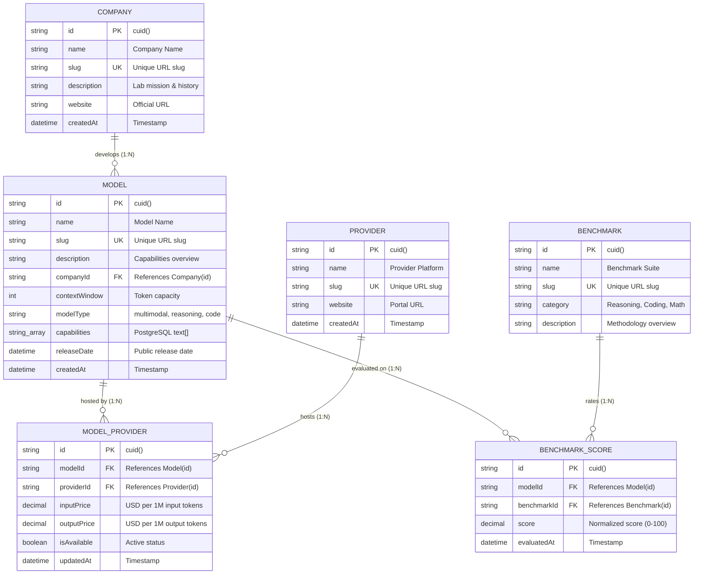

# OneAtlas — Relational Database Design & Architecture

Welcome to the architectural design document for **OneAtlas**, an AI Model Discovery and Intelligence Platform. This document provides a technical walkthrough of the relational database architecture designed for Phase 2 of our Backend Engineer assessment.

---

## 1. Entity-Relationship Overview

The database models the AI ecosystem using **six normalized relational tables**:

---

## 2. Table-by-Table Technical Breakdown

### 1. `companies` (`Company`)
* **Purpose:** Represents the AI research organizations and creators (e.g., OpenAI, Anthropic, Google DeepMind, Meta AI).
* **Primary Key:** `id` (`String @id @default(cuid())`) — collision-resistant unique identifier.
* **Key Columns:**
  * `slug`: Unique text string for URL routing (e.g., `/companies/anthropic`).
  * `description`: Overview of lab research priorities.
  * `website`: Official portal link.
* **Relationship:** One-to-Many (`1:N`) with `Model`. A company can release many models; each model belongs strictly to one company.

### 2. `models` (`Model`)
* **Purpose:** The core entity representing AI model architectures (e.g., GPT-4o, Claude 3.5 Sonnet, Llama 3.1 405B).
* **Primary Key:** `id` (`String @id @default(cuid())`).
* **Foreign Key:** `companyId` referencing `companies(id)` with `onDelete: Cascade`.
* **Key Columns:**
  * `slug`: Unique identifier for discovery routes (e.g., `/models/claude-3-5-sonnet`).
  * `contextWindow`: Integer specifying max token context (e.g., `128000`, `2000000`).
  * `modelType`: High-level category (e.g., `"multimodal"`, `"reasoning"`, `"code"`, `"text-only"`).
  * `capabilities`: Stored as a **native PostgreSQL text array (`text[]`)** (e.g., `["text", "vision", "code", "reasoning"]`). This allows flexible tagging without requiring an unnecessary join table.
  * `releaseDate`: Timestamp of commercial or public availability.
* **Indexes:** `@@index([companyId])` for fast foreign key filtering, and `@@index([modelType])` for category queries.

### 3. `providers` (`Provider`)
* **Purpose:** Represents inference platforms and hosting cloud providers that serve models via API (e.g., Amazon Bedrock, Microsoft Azure AI, Google Vertex AI, OpenRouter).
* **Primary Key:** `id` (`String @id @default(cuid())`).
* **Key Columns:**
  * `name`: Provider branding.
  * `slug`: Unique slug for URL lookups.
  * `website`: Documentation and developer console link.

### 4. `model_providers` (`ModelProvider`) — Junction Table
* **Purpose:** Resolves the Many-to-Many (`M:N`) relationship between `Model` and `Provider`, attaching specific pricing and availability metadata.
* **Primary Key:** `id` (`String @id @default(cuid())`).
* **Foreign Keys:**
  * `modelId` referencing `models(id)` with `onDelete: Cascade`.
  * `providerId` referencing `providers(id)` with `onDelete: Cascade`.
* **Pricing Definition:**
  * `inputPrice Decimal @db.Decimal(10, 4)`: Price in **USD per 1,000,000 (1M) input tokens**.
  * `outputPrice Decimal @db.Decimal(10, 4)`: Price in **USD per 1,000,000 (1M) output tokens**.
  * *Why Decimal(10, 4)?* Float arithmetic incurs rounding inaccuracies. Using SQL `DECIMAL` guarantees exact currency representation down to fractions of a cent (e.g., `$0.0375` per 1M tokens).
* **Constraints:**
  * `@@unique([modelId, providerId])`: Enforces that a model cannot have duplicate pricing records for the exact same provider.
  * Indexes on `modelId` and `providerId` optimize fast join lookups.

### 5. `benchmarks` (`Benchmark`)
* **Purpose:** Defines standardized evaluation suites used to rank and compare AI models (e.g., MMLU, HumanEval, GSM8K, GPQA, SWE-bench).
* **Primary Key:** `id` (`String @id @default(cuid())`).
* **Key Columns:**
  * `name`: Formal name of the benchmark suite.
  * `slug`: Unique identifier for benchmark leaderboards (e.g., `/benchmarks/humaneval`).
  * `category`: Classification domain (e.g., `"Coding"`, `"Mathematics"`, `"General Knowledge"`, `"Reasoning"`).

### 6. `benchmark_scores` (`BenchmarkScore`) — Junction Table
* **Purpose:** Records empirical evaluation performance of a model against a specific benchmark.
* **Primary Key:** `id` (`String @id @default(cuid())`).
* **Foreign Keys:**
  * `modelId` referencing `models(id)` with `onDelete: Cascade`.
  * `benchmarkId` referencing `benchmarks(id)` with `onDelete: Cascade`.
* **Score Definition:**
  * `score Decimal @db.Decimal(6, 2)`: Standardized percentage or benchmark metric (e.g., `93.70%`).
* **Constraints:**
  * `@@unique([modelId, benchmarkId])`: Guarantees one recorded score per model per benchmark suite.
  * `evaluatedAt`: Timestamp recording evaluation date.

---

## 3. Why PostgreSQL Was Selected

1. **Relational Integrity & ACID Guarantees:** AI models, providers, and pricing inherently require strong referential integrity. Foreign keys and cascade rules prevent orphaned data.
2. **Native Array Support (`TEXT[]`):** PostgreSQL natively supports typed arrays. We store `capabilities` as `String[]` without needing a complex sub-table or slower JSON string parsing.
3. **Exact Numeric Types (`DECIMAL`):** Tokens are priced in micro-dollars per token or dollars per million tokens. Floating point math is strictly unacceptable in billing systems; PostgreSQL's arbitrary precision `DECIMAL` preserves financial accuracy.
4. **Compound Unique Constraints & Indexes:** Composite keys like `[modelId, providerId]` prevent race conditions and duplicate cataloging.

---

## 4. Why Prisma ORM Was Selected

1. **End-to-End Type Safety:** When we query `prisma.model.findUnique({ include: { company: true, providers: true } })`, TypeScript automatically infers the exact returned object shape, preventing runtime bugs in our API route handlers.
2. **Declarative & Version-Controlled Migrations:** Prisma translates our schema into standard SQL migration files (`prisma/migrations/20261122112401_init_ai_discovery_schema/migration.sql`), allowing every database schema change to be tracked in Git.
3. **Parameterized SQL Queries:** Prisma handles query parameterization under the hood, completely eliminating SQL injection vectors.
4. **Clean Idempotent Seeding:** Prisma's `upsert` API makes seed scripts deterministic and repeatable across development and testing environments.

---

## 5. Sample Data Notice

All inserted model specifications, context windows, token pricing figures (USD/1M tokens), and benchmark evaluation scores are **illustrative sample data** generated solely for technical demonstration and assessment testing. They are not intended as certified real-world benchmarks.
