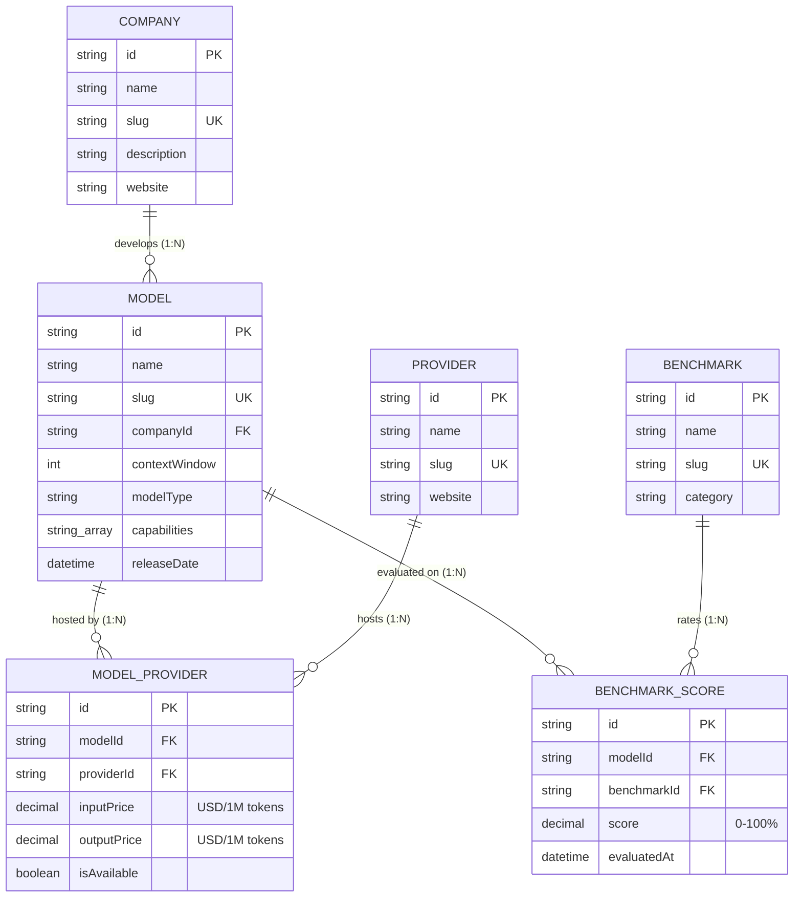

# OneAtlas — AI Model Discovery & Intelligence Platform

> **Backend Engineer Internship Assessment Project**  
> Built with Next.js App Router, TypeScript, PostgreSQL, Prisma ORM, Tailwind CSS, and Zod.

[](https://nextjs.org/)
[](https://www.typescriptlang.org/)
[](https://www.postgresql.org/)
[](https://www.prisma.io/)
[](https://tailwindcss.com/)
[](https://zod.dev/)

---

## 1. Project Overview & Scope

**OneAtlas** is a backend-focused discovery and intelligence engine for exploring foundation AI models, evaluating multi-provider token economics, inspecting hardware context windows, and comparing standardized benchmark leaderboards.

The primary objective of this project is to demonstrate clean, maintainable backend engineering:
- Relational data modeling with foreign key constraints and compound unique indexes.
- Type-safe, defensive REST APIs using Next.js Route Handlers and Zod schemas.
- Database-level search, multi-field filtering, sorting, and pagination (preventing in-memory array filtering).
- Graceful error shielding (never leaking SQL queries, database credentials, or internal stack traces).
- A clean, functional developer interface that directly demonstrates the backend APIs.

---

## 2. Technology Stack

| Layer | Technology | Rationale & Architectural Fit |
| :--- | :--- | :--- |
| **Framework** | Next.js 16 (App Router) | Unified server-first runtime; provides Route Handlers for REST APIs and React Server Components for streaming UI. |
| **Language** | TypeScript 5 | Strict static typing across database schemas, API response contracts, and UI components. |
| **Database** | PostgreSQL | Enterprise relational database supporting ACID transactions, compound unique constraints, and native `text[]` arrays. |
| **ORM** | Prisma ORM 6.19.3 | Declarative schema definitions, version-controlled SQL migrations, parameterized queries, and type generation. |
| **Validation** | Zod | Runtime schema validation for query parameters, preventing invalid inputs from reaching the database. |
| **Styling** | Tailwind CSS 4 | Clean, responsive developer-platform design with dark mode support. |

---

## 3. Relational Database Architecture

The PostgreSQL database is organized into **six normalized relational tables**:



*For complete schema design decisions, see [DATABASE_DESIGN.md](DATABASE_DESIGN.md).*

---

## 4. REST API Endpoints

All endpoints return a standardized JSON envelope (`{ success: true, data: ..., meta: ... }`):

| Method | Endpoint | Description |
| :---: | :--- | :--- |
| `GET` | `/api/models` | Discover models with search (`search`), filters (`company`, `provider`, `capability`, `modelType`), sorting (`sortBy`, `sortOrder`), and pagination (`page`, `limit`). |
| `GET` | `/api/models/[id]` | Inspect a single model by CUID ID or URL slug (e.g., `gpt-4o`, `claude-3-5-sonnet`). |
| `GET` | `/api/companies` | List all AI research labs with their model counts. |
| `GET` | `/api/providers` | List all cloud inference hosts with hosted model counts. |
| `GET` | `/api/providers/[id]/models` | List all models and token pricing for a specific provider. |
| `GET` | `/api/benchmarks` | List all benchmark suites (MMLU, HumanEval, GSM8K, GPQA, SWE-bench). |
| `GET` | `/api/rankings` | Leaderboard ranked by score descending (`?benchmark=mmlu`). |
| `GET` | `/api/compare` | Compare 2–4 models side-by-side (`?ids=gpt-4o,claude-3-5-sonnet`). |
| `GET` | `/api/health` | Live system uptime and real PostgreSQL database probe. |

*For complete request examples and response schemas, see [API_DOCUMENTATION.md](API_DOCUMENTATION.md).*

---

## 5. Local Setup Instructions

### Prerequisites
- Node.js `v20.x` or `v24.x`
- npm `v10.x` or higher
- A running PostgreSQL database (Local or cloud hosted such as Neon or Supabase)

### Step 1: Clone the Repository
```bash
git clone https://github.com/your-username/oneatlas-ai-platform.git
cd oneatlas-ai-platform
```

### Step 2: Install Dependencies
```bash
npm install
```
*(Prisma Client will be generated automatically via `postinstall`)*

### Step 3: Configure Environment Variables
Copy the template to create your `.env` file:
```bash
cp .env.example .env
```
Open `.env` and set your PostgreSQL connection string:
```env
DATABASE_URL="postgresql://<USER>:<PASSWORD>@<HOST>:<PORT>/<DATABASE>?schema=public"
NODE_ENV="development"
```

### Step 4: Run Migrations and Seed Data
Apply the existing migration and execute the idempotent seed script:
```bash
npx prisma migrate dev
npm run db:seed
```

### Step 5: Start Development Server
```bash
npm run dev
```
Open your browser at [http://localhost:3000](http://localhost:3000).

---

## 6. Verification and Automated Testing

OneAtlas includes a complete automated test suite verifying both API behavior and frontend route rendering:

```bash
# 1. Run all 13 backend REST API automated tests
npm run test:api

# 2. Run frontend HTML route verification
npm run test:frontend

# 3. Compile optimized production build
npm run build

# 4. (Optional) Open Prisma Studio to browse database rows visually
npm run studio
```

---

## 7. Deployment Instructions (Vercel + Hosted PostgreSQL)

### Step 1: Host the Database
Ensure your PostgreSQL database is hosted on a cloud provider like [Neon](https://neon.tech) or [Supabase](https://supabase.com). The connection string must use SSL (`?sslmode=require`).

### Step 2: Deploy to Vercel
1. Push the code to a GitHub repository (`oneatlas-ai-platform`).
2. Log in to [Vercel](https://vercel.com) and click **Add New Project**.
3. Import your `oneatlas-ai-platform` repository.
4. Under **Environment Variables**, add:
   - `DATABASE_URL`: Your hosted PostgreSQL connection string.
   - `NODE_ENV`: `production`
5. Click **Deploy**.

Vercel will run `npm install` (triggering `postinstall: prisma generate`) and compile the Next.js application with zero manual build steps.

---

## 8. Sample Data Notice

All inserted AI model specifications, context window limits, token pricing figures (USD per 1M tokens), and benchmark evaluation scores are **illustrative sample data** seeded for technical demonstration and assessment testing. They are not certified real-world measurements.

---

## 9. Known Limitations & Technical Decisions

- **Floating-Point Number Serialization:** Token prices are stored in PostgreSQL using exact `DECIMAL(10, 4)` types. When serialized to JSON for API responses, they are formatted into native JavaScript numbers for clean JSON consumption and frontend display.
- **Comparison Limit:** Multi-model comparison (`/api/compare`) is capped between 2 and 4 models to maintain table readability on mobile and desktop viewports.
- **Cache Components:** Suspense streaming boundaries are used across server components to ensure fast initial page loads while database content streams in dynamically.
